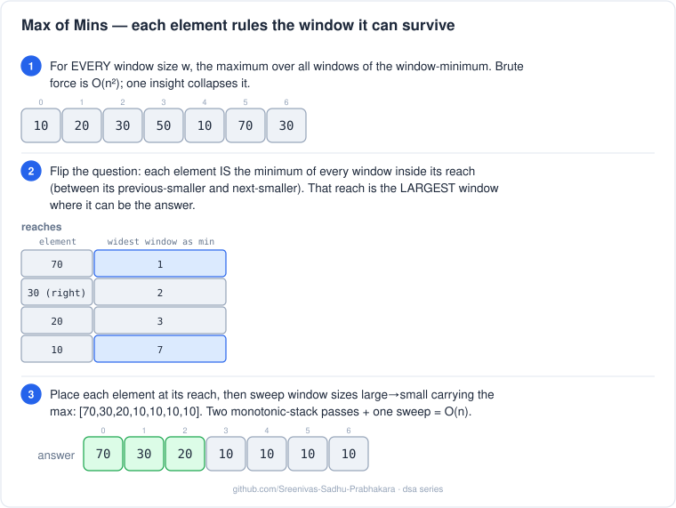

# Maximum of Minimums of Every Window Size

> Striver SDE Sheet 090 · Day 14 Stack & Queue II — each element rules the window sized by its smaller neighbors; bucket those reigns, cascade down. Go, stdlib only, tested.

## Problem

For every window length w from 1 to n, compute the maximum over all windows of that length of each window's *minimum* — all n answers at once, not one sliding-window pass per size (that's O(n²)).

## Approach

Flip the question from windows to elements: each element is the minimum of every window contained between its nearest strictly smaller neighbors — a reign whose widest window has length `right[i] − left[i] − 1`. Two monotonic-stack passes (previous-smaller, next-smaller) find those boundaries in O(n). Drop each element into the answer bucket of its widest reign, then cascade from large windows to small: a value that is some window-of-size-w's minimum is also achievable at size w−1 (shrink the window around the same element), so `ans[w] = max(ans[w], ans[w+1])` fills the gaps. Three linear passes in total.

**Complexity:** O(n) time, O(n) space.

## Visual walkthrough

Read the picture top to bottom — each numbered frame is one moment of the algorithm
running on this repo's test example.

## Run

    go test ./...   # verify
    go run .        # demo

---

One of 191 repos solving Striver's SDE Sheet in Go — stdlib only, one problem per repo, every solution tested. Browse the set: [`dsa-*` repos](https://github.com/Sreenivas-Sadhu-Prabhakara?tab=repositories&q=dsa-&type=source).
